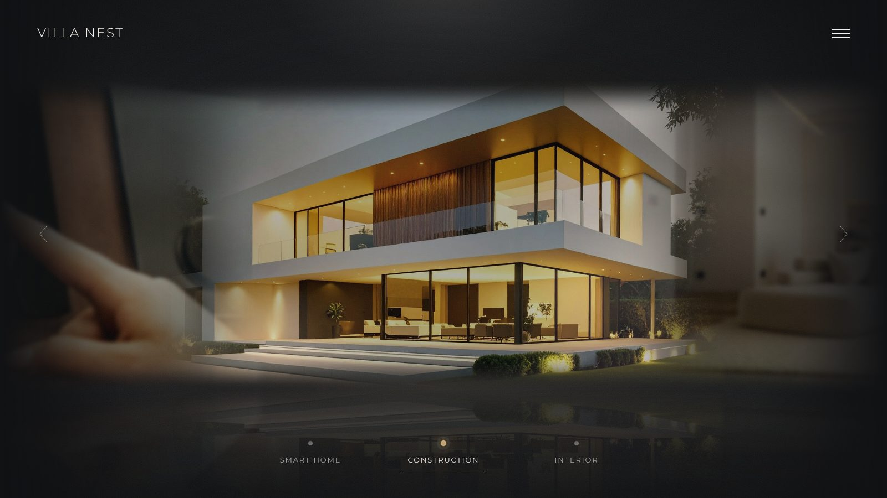
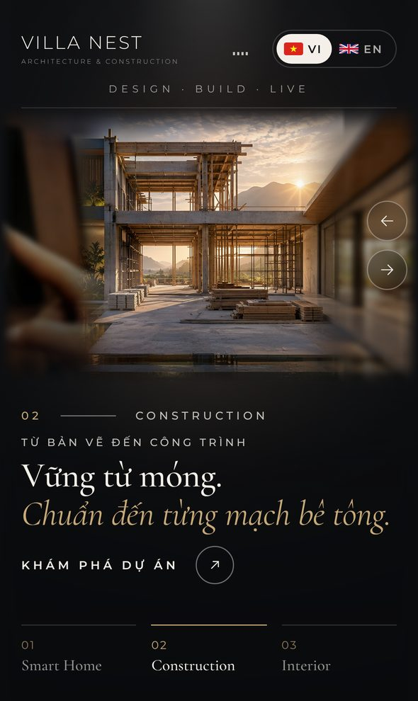
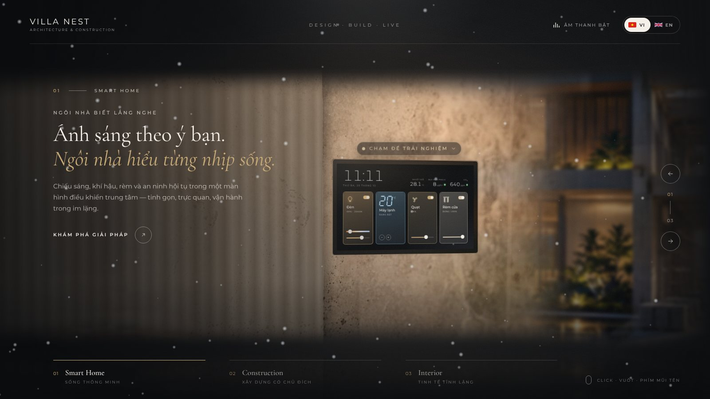

# VILLA NEST — Architecture · Interior · Smart Home

Website cao cấp cho thương hiệu **VILLA NEST** — *Design · Build · Live*. Trang chủ là một **bức toàn cảnh 3D điện
ảnh, liền mạch**: bức tường với màn hình điều khiển trung tâm của hệ thống **Smart Home** → công trình đang
**xây dựng** với giáo chống, ván khuôn → **nội thất** hoàn thiện, nối tiếp nhau như những bức tường cong của một căn
phòng — cuối ảnh này ăn khớp với đầu ảnh kia — và xoay để chuyển cảnh khi bấm, kéo hay vuốt. Song ngữ Việt / Anh
(mặc định tiếng Việt), có tiếng gió nhẹ khi chuyển cảnh (tắt được) và link riêng cho từng lĩnh vực.







## Điểm nổi bật

- **Ba ảnh hòa làm một**: các tấm ảnh được "bản lề" vào nhau trên một đa giác nhìn từ bên trong (tường cong), nên
  mép phải tấm này luôn trùng khít mép trái tấm kia ở mọi khung hình, kể cả khi đang xoay. Hai ảnh kề nhau chồng lên
  nhau một dải hẹp và hòa dần vào nhau (`mask-image`); khi xử lý ảnh, màu và ánh sáng ở hai mép chạm nhau còn được
  kéo về cùng một tông nên đường nối gần như biến mất.
- **Mở màn ~2 giây**: màn hình tối → máy quay lia nhẹ qua bức toàn cảnh, công trình hiện ra từ bóng tối và lấy nét →
  header, tiêu đề, thanh điều hướng hiện lên lần lượt.
- **Giao diện biên tập**: header có chữ VILLA NEST, slogan *DESIGN · BUILD · LIVE*, nút âm thanh và nút chọn ngôn ngữ (cờ VI/EN);
  mỗi lĩnh vực có tiêu đề serif lớn với dòng nghiêng màu vàng, mô tả và nút "Khám phá"; chữ đổi theo hiệu ứng khi
  chuyển cảnh; thanh điều hướng 01 · 02 · 03 kèm phụ đề; nút mũi tên dọc với bộ đếm; gợi ý "Click · Vuốt · Phím mũi tên".
- **Song ngữ**: tiếng Việt mặc định, chọn tiếng Anh bằng cờ (trình duyệt nhớ lựa chọn), hoặc mở `?lang=en`.
- **Bảng điều khiển nhà thông minh bấm được** (cảnh Smart Home): bảng điều khiển được **lắp âm vào tường đá**, hơi
  nghiêng theo mặt tường (10°, vẫn dễ bấm) — màn hình là giao diện thật, nghiêng đúng phối cảnh của ảnh. Phía trên có
  dòng **"Chạm để trải nghiệm"** nhấp nhô mời bấm. Đầu màn hình là giờ (theo đồng hồ máy), ngày và ba chỉ số phòng:
  **Nhiệt độ**, **Bụi mịn PM2.5** và **CO₂**, kèm chấm màu chất lượng không khí (xanh tốt · vàng trung bình · đỏ kém) —
  số liệu mô phỏng: bật máy lạnh thì phòng mát dần về nhiệt độ cài đặt và bụi mịn giảm, tắt thì ấm dần trở lại.
  Bốn thẻ **Đèn**, **Máy lạnh**, **Quạt**, **Rèm cửa**: chạm vào thẻ để bật / tắt nhanh; đèn, quạt, rèm có **thanh kéo**
  chỉnh mức 1–100 % (kéo thanh cũng tự bật thiết bị). Lần đầu bật đèn, quạt ở mức **69 %**, rèm **đóng 100 %**; tắt
  rồi bật lại thì về đúng mức trước khi tắt — các mức, màu đèn và nhiệt độ được trình duyệt nhớ cả cho lần truy cập sau
  (mỗi lần mở trang mọi thiết bị đều đang tắt).
  - **Đèn**: căn phòng sáng lên / tối đi nhanh (~0,8 giây), tắt đèn phòng tối hẳn, bật đèn tường sáng rõ. Thanh **nhiệt
    độ màu** (2700–6500 K, từ vàng ấm đến trắng ban ngày) nằm ngay trên thanh độ sáng; thẻ hiện ví dụ `69% · 3000K`.
  - **Máy lạnh**: nhiệt độ hiện bằng số 7 thanh, nút − / + chỉnh 16–30 °C; bông tuyết mờ nhẹ rơi khắp màn hình —
    **càng lạnh tuyết càng dày**.
  - **Quạt**: lá cây bay ngang màn hình; nếu máy lạnh đang bật thì không có lá mà **bông tuyết bị gió thổi sang phải**
    (lá đang bay sẽ mờ dần khi bật máy lạnh) — **quạt càng mạnh, lá và tuyết bay càng nhanh**, rèm đang kéo thì **bay
    phấp phới theo gió**; cánh quạt trên thẻ quay nhanh hơn. Tắt quạt thì lá rơi xuống.
  - **Rèm cửa**: rèm voan chạy như rèm motor thật — khởi động và dừng êm, tốc độ đều (~4 giây từ mở hẳn đến đóng hẳn),
    gấu rèm còn đung đưa theo quán tính khi dừng; mức trên thanh là độ đóng. Rèm phủ ngang màn hình, trước căn phòng
    (có cả bóng phản chiếu trên sàn) và mờ đi khi chuyển sang lĩnh vực khác. Trên máy tính một tấm rèm kéo từ **mép
    ngoài cùng bên trái màn hình** vào tới **sát cạnh trái bảng điều khiển** (bảng luôn để trống, kể cả khi gió thổi).
    Trên điện thoại hai tấm rèm kéo vào từ **sát mép trái và mép phải** màn hình, nằm **dưới bảng điều khiển phóng to**;
    chạm ra ngoài (hoặc nút "Đóng") để thoát bảng thì **rèm tự kéo ra**.
  Tuyết / lá chỉ chạy khi Smart Home đang ở giữa (canvas, dừng hẳn khi tắt hết). Trên điện thoại màn hình trên tường
  quá nhỏ để bấm, nên chạm vào nó sẽ mở bảng điều khiển phóng to **gọn ở cuối màn hình** (giờ và chỉ số một hàng, bốn
  thẻ 2 × 2), để vẫn thấy gần hết căn phòng và rèm kéo vào; xoay ngang điện thoại thì bảng dùng bố cục 4 thẻ một hàng như
  trên tường. Người dùng bật "giảm chuyển động" chỉ thấy bảng đổi trạng thái, ánh sáng và rèm, không có tuyết / lá.
- **Âm thanh chuyển cảnh**: không có nhạc nền; mỗi lần chuyển cảnh có một tiếng "xẹt" nhẹ như gió thổi, âm lượng
  nhỏ, lướt theo hướng chuyển (trái → phải hoặc ngược lại). Tổng hợp ngay trong trình duyệt bằng Web Audio (không cần
  file âm thanh, chạy offline). Mặc định bật, kêu từ lần bấm / chạm đầu tiên (trình duyệt không cho phát âm thanh
  trước đó); nút âm thanh trên header tắt / bật lại và trình duyệt nhớ lựa chọn.
- **Link riêng từng lĩnh vực**: `/#smart-home`, `/#construction`, `/#interior` — địa chỉ tự cập nhật khi chuyển cảnh.
- **Chiều sâu điện ảnh**: ảnh hai bên nghiêng ±12°, nhoè và tối dần ra mép màn hình; mép trên/dưới tan vào bóng tối;
  phản chiếu trên sàn bóng, ánh sáng môi trường đổi màu theo ảnh ở giữa, vignette và film grain.
- **Vòng xoay vô hạn, không giật**: toàn bộ trạng thái là một số liên tục `progress`; mỗi ảnh có hai bản sao quanh
  vòng nên cả hai mép màn hình luôn có ảnh nối tiếp, không bao giờ trống hay nhảy vị trí.
- **Tương tác đầy đủ**: click ảnh bên, kéo chuột, vuốt cảm ứng có quán tính, phím ← →, bánh xe chuột / trackpad,
  nút mũi tên, nhãn bên dưới, hover (ảnh bên sáng lên), parallax nhẹ theo chuột.
- **Ảnh nội bộ, sắc nét**: AVIF (4:4:4, chất lượng cao) + WebP, 5 kích thước tới 3200 px cho màn hình Retina/4K và
  bản dọc cho điện thoại, thu nhỏ bằng Lanczos và làm nét nhẹ. Ảnh được tải
  **và giải mã** trước khi cảnh xuất hiện — không bao giờ có khung trắng khi chuyển cảnh. Không phụ thuộc CDN hay
  Internet (font cũng được đóng gói cục bộ).
- **Nhẹ cho GPU**: chỉ dùng CSS 3D transform / opacity / filter, không WebGL. Tự chuyển sang chế độ nhẹ khi FPS thấp,
  tôn trọng `prefers-reduced-motion`.

## Công nghệ

React 19 · Vite 8 · TypeScript · GSAP 3 · CSS 3D Transforms · CSS Mask Image · Web Audio · sharp (xử lý ảnh) ·
Montserrat + Cormorant Garamond (Fontsource, tự host, đủ dấu tiếng Việt).

## Yêu cầu

- **Node.js 20.19+** hoặc **22.12+** (kèm npm 10+).

## Cài đặt & chạy thử

```bash
npm install
npm run dev          # http://localhost:5173  (mở được từ điện thoại cùng mạng LAN: http://<IP-máy>:5173)
```

Các lệnh khác:

| Lệnh                | Tác dụng                                                     |
| ------------------- | ------------------------------------------------------------ |
| `npm run build`     | Kiểm tra TypeScript và build website tĩnh vào `dist/`        |
| `npm run preview`   | Chạy bản build tại http://localhost:4173                     |
| `npm run typecheck` | Chỉ kiểm tra TypeScript                                      |
| `npm run lint`      | Kiểm tra mã nguồn (oxlint)                                   |
| `npm run images`    | Tạo lại toàn bộ ảnh tối ưu từ `assets-src/` (xem phần Thay ảnh) |

## Build & triển khai bằng Nginx

```bash
npm run build                                    # → thư mục dist/
sudo mkdir -p /var/www/villa-nest
sudo cp -r dist/. /var/www/villa-nest/
sudo cp deploy/nginx.conf /etc/nginx/conf.d/villa-nest.conf   # sửa server_name / root cho phù hợp
sudo nginx -t && sudo systemctl reload nginx
sudo certbot --nginx -d ten-mien-cua-ban.vn      # (tuỳ chọn) bật HTTPS
```

File [`deploy/nginx.conf`](deploy/nginx.conf) đã cấu hình sẵn: gzip, cache 1 năm cho JS/CSS/font có hash, cache 30
ngày cho ảnh, `no-cache` cho `index.html` (triển khai bản mới là thấy ngay), header bảo mật cơ bản, và chuyển mọi URL
lạ về trang chủ. Nếu Nginx của bạn cũ hơn 1.24 và chưa biết định dạng AVIF, thêm dòng `image/avif avif;` vào
`/etc/nginx/mime.types`.

**Raspberry Pi:** xem hướng dẫn riêng [`docs/RASPBERRY-PI.md`](docs/RASPBERRY-PI.md) — có script cài tự động
`bash deploy/install-pi.sh`.

**Tên miền qua Cloudflare** (HTTPS, không cần mở cổng modem): xem [`docs/CLOUDFLARE.md`](docs/CLOUDFLARE.md).

Chẩn đoán trên Pi (chỉ đọc, không sửa gì): `bash deploy/doctor-pi.sh`.

Bản build dùng đường dẫn tương đối (`base: './'`) nên có thể đặt ở gốc tên miền hoặc trong thư mục con
(ví dụ `https://example.com/villa/`). Website cần được phục vụ qua HTTP (Nginx, `npm run preview`, hoặc bất kỳ
static server nào); mở trực tiếp `dist/index.html` bằng `file://` sẽ bị trình duyệt chặn module JavaScript.

## Cấu trúc thư mục

```
├── assets-src/                 Ảnh gốc độ phân giải cao (đầu vào của npm run images)
├── deploy/
│   ├── nginx.conf              Cấu hình Nginx mẫu
│   ├── install-pi.sh           Script cài lên Raspberry Pi / Debian / Ubuntu (sao lưu, không đụng site khác)
│   └── doctor-pi.sh            Chẩn đoán các website trên Pi (chỉ đọc)
├── docs/                       Ảnh chụp màn hình, hướng dẫn Raspberry Pi
├── public/
│   ├── assets/slides/          Tấm toàn cảnh đã tối ưu: AVIF/WebP ngang, dọc, ambient (sinh tự động)
│   └── favicon.svg
├── scripts/optimize-images.mjs Pipeline ảnh: chỉnh màu, cắt tấm, hòa mép, resize, mã hoá AVIF/WebP
└── src/
    ├── App.tsx                 Ghép Header, Loader, HeroCarousel; âm thanh; link #lĩnh-vực
    ├── config/animation.ts     ★ Toàn bộ thông số hiệu ứng / chuyển động / bố cục
    ├── assets/brand/           (tuỳ chọn) logo công ty: logo.svg / logo.png / logo.webp
    ├── audio/TransitionSound.ts Tiếng gió khi chuyển cảnh, tổng hợp bằng Web Audio
    ├── i18n/                   Ngôn ngữ: strings.ts (chữ giao diện VI/EN), LanguageProvider
    ├── data/
    │   ├── slides.ts           ★ Nội dung song ngữ của 3 lĩnh vực (tiêu đề, mô tả, nút, link)
    │   └── media.json          Cấu hình ảnh: kích thước, điểm lấy nét, chỉnh màu (dùng chung với script)
    ├── components/
    │   ├── HeroCarousel/
    │   │   ├── HeroCarousel.tsx    Markup + nạp trước ảnh + nối React với engine
    │   │   ├── CarouselEngine.ts   Engine GSAP: progress, kéo/vuốt/phím/wheel, intro, chế độ nhẹ
    │   │   ├── carouselMath.ts     Toán thuần: trạng thái CENTER/LEFT/RIGHT, mask làm mềm cạnh
    │   │   ├── HeroCopy.tsx        Khối chữ: số thứ tự, tiêu đề serif, mô tả, nút "Khám phá"
    │   │   ├── SlideImage.tsx      <picture> AVIF/WebP, art-direction ngang/dọc
    │   │   └── HeroCarousel.css
    │   ├── SmartHome/          Bảng điều khiển (ControlScreen), tường: ánh sáng, lời mời (HomeWall), rèm (Curtains), tuyết / lá (SceneEffects)
    │   ├── Header/             Logo, slogan, nút âm thanh, chọn ngôn ngữ
    │   └── Loader/             Vạch tiến trình tối giản khi ảnh đang tải
    ├── styles/                 tokens.css (màu, font, khoảng cách) · global.css
    └── utils/device.ts         Nhận diện chế độ chất lượng & media query
```

## Tinh chỉnh hiệu ứng

Mọi thông số nằm trong [`src/config/animation.ts`](src/config/animation.ts). Khi chạy `npm run dev`, lưu file là
trang tự cập nhật.

| Thông số             | Mặc định        | Ý nghĩa                                                                     |
| -------------------- | --------------- | --------------------------------------------------------------------------- |
| `transitionDuration` | `1.1`           | Thời gian (giây) chuyển một slide khi click / phím / nhãn                   |
| `ease`               | `power3.inOut`  | Easing của GSAP cho chuyển cảnh                                             |
| `releaseEase`        | `power3.out`    | Easing khi thả tay sau khi kéo/vuốt (giữ quán tính)                         |
| `dragSensitivity`    | `1`             | Độ nhạy kéo/vuốt: 1 = ảnh bám theo ngón tay 1:1                             |
| `flickVelocity`      | `0.35`          | Tốc độ (slide/giây) tối thiểu để một cú vuốt nhanh được tính là chuyển slide |
| `sideRotate`         | `12`            | Góc (độ) giữa hai tấm kề nhau — độ cong của bức tường: trái +12°, phải −12°. Nên 6–20 |
| `sideOpacity`        | `1`             | Độ đục ảnh hai bên (giữ 1 để toàn cảnh liền mạch)                           |
| `sideBlur`           | `3`             | Độ nhoè (px) ảnh hai bên (0 = tắt filter blur)                              |
| `sideBrightness`     | `0.62`          | Độ sáng ảnh hai bên (1 = giữ nguyên)                                        |
| `perspective`        | `1300`          | Khoảng phối cảnh CSS (px); càng nhỏ 3D càng mạnh                            |
| `fadeStrength`       | `0.5`           | Độ mềm của mép trên/dưới: 0 ≈ cạnh gọn, 1 = rất mềm, mơ màng                 |
| `seam`               | `0.22`          | Bề rộng dải hòa trộn giữa hai ảnh kề nhau (lấy từ `media.json`, xem Thay ảnh) |
| `reflection`         | `0.22`          | Độ đậm phản chiếu trên sàn (0 = tắt)                                        |
| `ambientLight`       | `0.36`          | Độ mạnh ánh sáng màu hắt ra phòng từ ảnh trung tâm (0 = tắt)                |
| `parallaxTilt`       | `2`             | Góc nghiêng tối đa (độ) theo chuột trên desktop (0 = tắt)                   |
| `hover.*`            | —               | Ảnh bên khi rê chuột: sáng lên, bớt nhoè                                    |
| `intro.duration`     | `2.2`           | Thời gian lia máy và lấy nét của cảnh mở màn                                |
| `layouts.portrait`   | —               | Bố cục điện thoại / màn hình dọc (mỗi tấm rộng 80%, perspective 1000…)      |
| `layouts.landscape`  | —               | Bố cục desktop (mỗi tấm rộng 58% màn hình, tỉ lệ 3:2…)                      |

Màu sắc và font nằm trong [`src/styles/tokens.css`](src/styles/tokens.css): nền `#101113`, chữ `#F4F0E9`,
chữ phụ `#A6A6A6`, điểm nhấn `#C8AA78`.

## Logo công ty

Hiện header dùng chữ "VILLA NEST · Architecture & Construction". Nếu sau này muốn dùng logo dạng ảnh, đặt file (nền
trong suốt) vào `src/assets/brand/` với tên `logo.svg`, `logo.png` hoặc `logo.webp` rồi build lại.

## Nội dung & ngôn ngữ

- Chữ của từng lĩnh vực (tiêu đề, dòng nghiêng, mô tả, nút, link của nút) nằm trong `src/data/slides.ts`, mỗi lĩnh vực
  có bản `vi` và `en`.
- Chữ giao diện (slogan, nút âm thanh, gợi ý thao tác…) nằm trong `src/i18n/strings.ts`.
- Nút "Khám phá" hiện trỏ tới link riêng của lĩnh vực đó (`#construction`…); thay `ctaHref` bằng trang dự án thật khi có.

## Thay ảnh

> Ảnh Smart Home chỉ có mặt kính tối ở chỗ màn hình; vị trí màn hình (pixel trên ảnh gốc, trước khi nghiêng) nằm ở
> `images.smart-home.screen` trong `src/data/media.json` — `bezel` là bề rộng viền khung (rèm dừng trước viền này),
> `tilt` là góc nghiêng của bảng và khoảng nhìn của phép chiếu đã dùng khi ghép ảnh (màn hình trên web nghiêng đúng
> như vậy). Website tự quy đổi theo cách cắt ảnh ngang / dọc. Nếu thay ảnh này, cập nhật lại `sourceSize` và `screen`
> (bỏ `tilt` nếu bảng trong ảnh mới nhìn thẳng; xoá `screen` để không hiện bảng điều khiển).

1. Đặt ảnh gốc chất lượng cao vào `assets-src/`. Có hai loại nguồn:
   - **Ảnh riêng** cho một lĩnh vực (`images.<id>.source`), ví dụ `smart-home.jpg`;
   - **Dải toàn cảnh** (`strips`) — một ảnh rộng liền mạch được cắt thành nhiều tấm cạnh nhau, nên đường nối giữa các
     tấm đó trùng từng điểm ảnh. Hiện tại Construction và Interior được cắt từ
     `panorama-construction-interior.jpg` (ảnh concept 2000 px đã phóng to ×4 bằng Real-ESRGAN).
2. Chỉnh `src/data/media.json` nếu cần:
   - `order` — thứ tự ảnh trên bức toàn cảnh (ảnh cuối nối vòng về ảnh đầu),
   - `focus` — điểm canh khi cắt ảnh cho tấm ngang `[x, y]` (0–1),
   - `portraitFocusX` — vị trí cắt ngang cho tấm dọc trên điện thoại,
   - `grade` — chỉnh màu: `exposure`, `contrast`, `saturation`, `greens` (giảm xanh lá), `warmth`,
   - `geometry` — tỉ lệ tấm (`landscapeAspect`, `portraitAspect`) và `seam` (bề rộng dải hòa trộn),
   - `harmonize` — mức kéo màu hai mép chạm nhau về cùng tông (`strength` 0–1) và độ sâu vào trong ảnh (`reach`).
3. Chạy `npm run images` (luôn xử lý cả ba ảnh vì các mép phụ thuộc lẫn nhau; mất vài phút).
   Muốn xem nhanh đường nối trước: `PANORAMA_PREVIEW=preview.jpg node scripts/optimize-images.mjs` sẽ ghép ba ảnh
   thành một tấm `preview.jpg` rồi dừng.
4. Cập nhật mô tả `alt`, nhãn và thông tin tác giả trong `src/data/slides.ts`.

## Điều khiển

| Thiết bị    | Thao tác                                                                                   |
| ----------- | ------------------------------------------------------------------------------------------ |
| Chuột       | Click ảnh bên, kéo trái/phải, cuộn bánh xe, nút ← → bên phải, click nhãn 01–03, rê chuột lên ảnh bên |
| Cảm ứng     | Vuốt trái/phải (vuốt dọc không bị chặn), chạm ảnh bên, chạm nhãn                           |
| Bàn phím    | ← → chuyển slide; Tab tới nhãn / mũi tên / âm thanh / ngôn ngữ, Enter để chọn              |

## Hiệu năng & khả năng tiếp cận

- Ảnh được chọn theo màn hình (`srcset`/`sizes`, AVIF trước, WebP dự phòng) và giải mã trước khi hiển thị.
- Chỉ animate `transform`, `opacity`, `filter`; engine chỉ chạy vòng render khi có chuyển động.
- **Chế độ nhẹ** (không blur, không phản chiếu, không grain) tự bật khi hai lần chuyển cảnh chạy dưới 40 FPS,
  hoặc khi thiết bị rất yếu / bật Tiết kiệm dữ liệu. Ép chế độ bằng `?quality=low` hoặc `?quality=high`.
- `prefers-reduced-motion`: bỏ parallax, rút ngắn chuyển cảnh còn ~0,45 s, mở màn chỉ là fade.
- Có nhãn ARIA cho carousel và nút, vùng `aria-live` đọc tên lĩnh vực hiện tại, focus hiển thị rõ khi dùng bàn phím.

## Trình duyệt hỗ trợ

Chrome / Edge 111+, Firefox 114+, Safari 16.4+ (iPhone / iPad iOS 16.4+), Chrome Android — theo mục tiêu build mặc
định của Vite 8.

## Đã kiểm thử

Kiểm thử tự động bằng Playwright (Chromium) trên bản build:

- Desktop 1920×1080, 1440×900, 1280×720, 2560×1080; iPhone 14 Pro (cảm ứng), Android 360×800, iPad dọc 820×1180,
  điện thoại xoay ngang 844×390.
- Click ảnh bên, kéo chuột, kéo ngắn bật lại, vuốt cảm ứng, vuốt nhanh, vuốt dọc bị bỏ qua, phím ← → (kể cả bấm dồn
  dập qua điểm lặp vòng), bánh xe / trackpad (một cử chỉ = một slide), mũi tên, nhãn, logo, đổi ngôn ngữ VI/EN, bật/tắt âm thanh, link #lĩnh-vực.
- Kiểm tra từng khung hình 60 fps bằng đồng hồ giả lập: không có ảnh nào nhảy vị trí hay nhấp nháy khi lặp vòng.
- Không có lỗi console, không có request ra ngoài Internet, không có thanh cuộn ngang; chạy đúng sau Nginx với cấu hình
  trong `deploy/nginx.conf`.

## Bản quyền ảnh

Thay bằng ảnh dự án thật của VILLA NEST trước khi ra mắt chính thức.

- Construction, Interior — ảnh concept của VILLA NEST (`assets-src/panorama-construction-interior.jpg`).
- Smart Home — nền tường đá travertine từ ảnh của [HUUM](https://unsplash.com/photos/smart-thermostat-on-stone-wall-eJAWSL_0L98)
  ([Unsplash License](https://unsplash.com/license), miễn phí cho mục đích thương mại; thiết bị gốc đã được xoá),
  ánh sáng buổi tối và màn hình điều khiển trung tâm (giao diện VILLA NEST) được dựng thêm.
