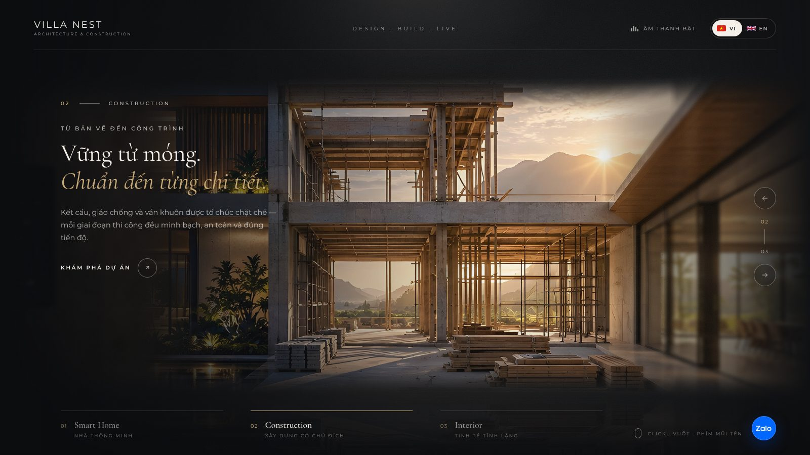
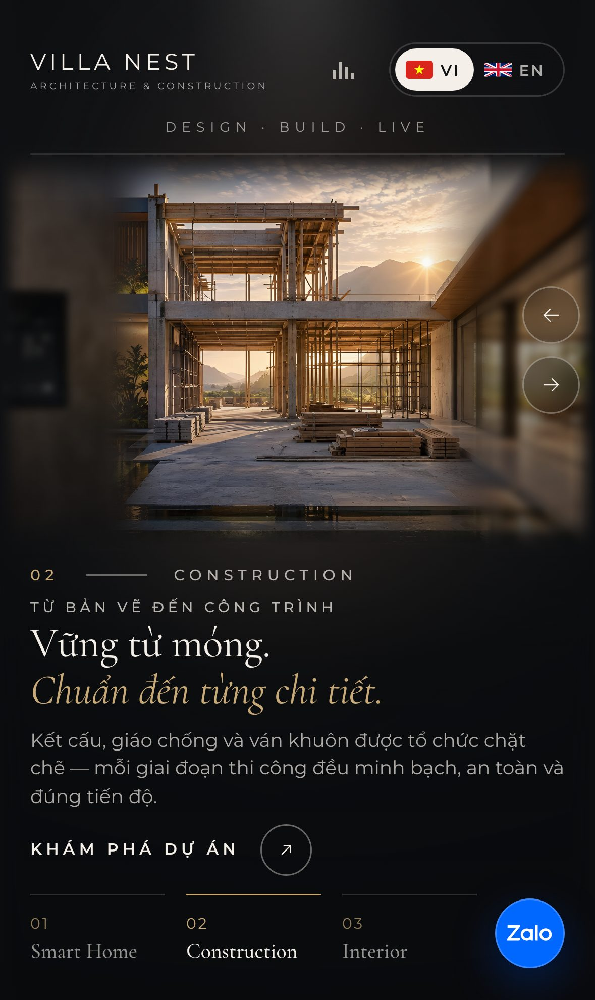
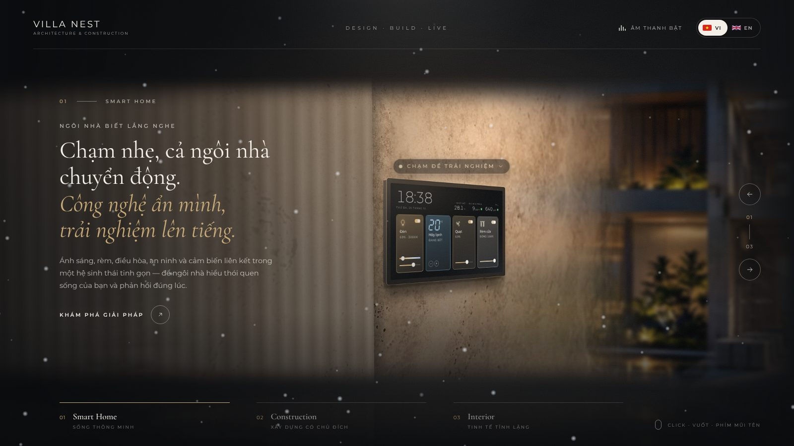
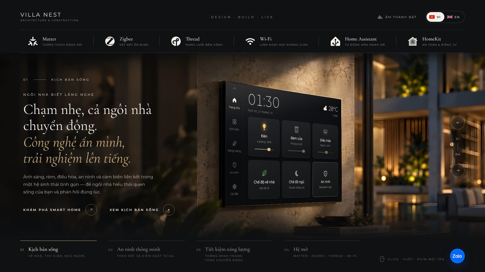
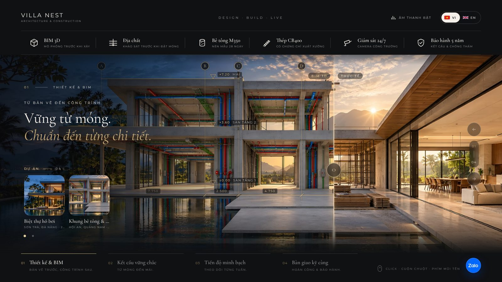
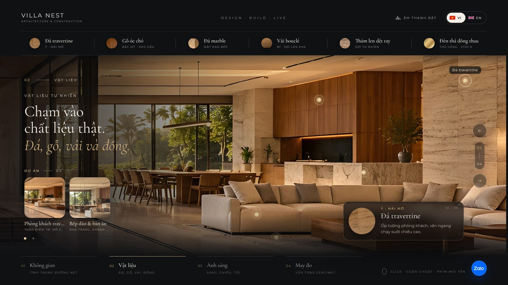
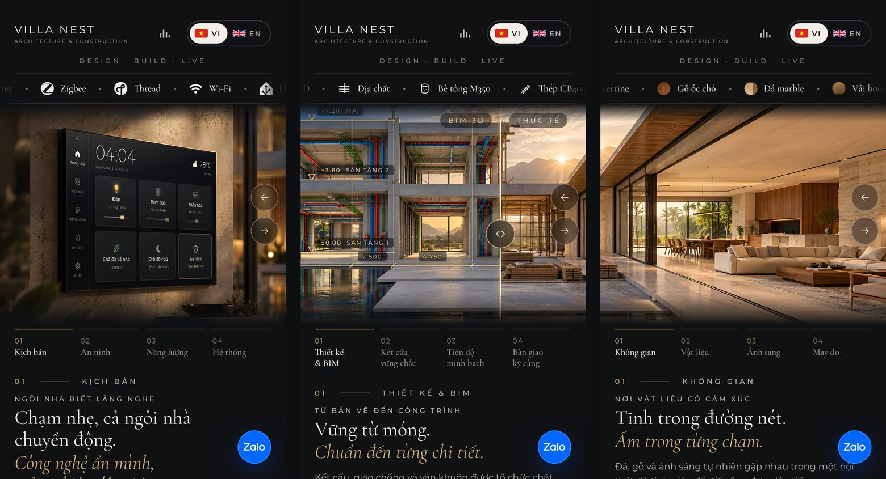
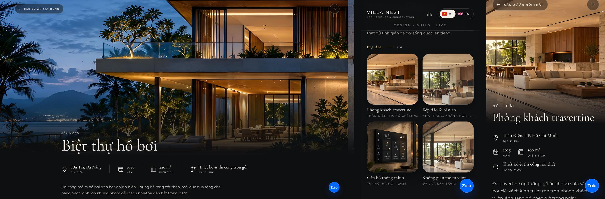
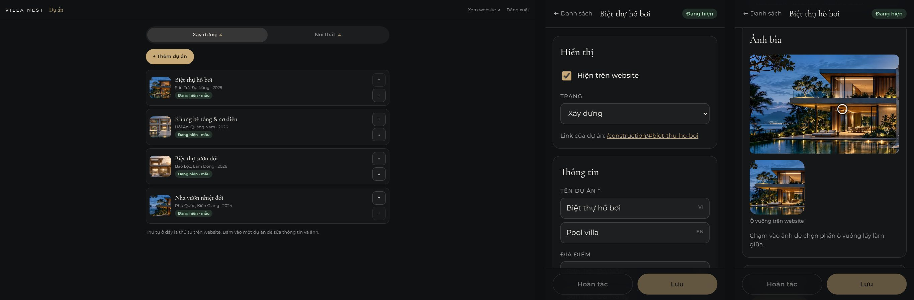

# VILLA NEST — Architecture · Interior · Smart Home

Website cao cấp cho thương hiệu **VILLA NEST** — *Design · Build · Live*. Trang chủ là một **bức toàn cảnh 3D điện
ảnh, liền mạch**: bức tường với màn hình điều khiển trung tâm của hệ thống **Smart Home** → công trình đang
**xây dựng** với giáo chống, ván khuôn → **nội thất** hoàn thiện, nối tiếp nhau như những bức tường cong của một căn
phòng — cuối ảnh này ăn khớp với đầu ảnh kia — và xoay để chuyển cảnh khi bấm, kéo hay vuốt. Mỗi lĩnh vực có **trang
riêng** cùng một phong cách: [`/smart-home/`](#trang-smart-home), [`/construction/`](#trang-xây-dựng),
[`/interior/`](#trang-nội-thất). Song ngữ Việt / Anh (mặc định tiếng Việt), tiếng "tít" của máy lạnh khi điều khiển
(tắt được), **nút nhắn tin** ở góc dưới phải mọi trang (Facebook, WhatsApp, Zalo), link riêng cho từng lĩnh vực.

















## Điểm nổi bật

- **Ba ảnh hòa làm một**: các tấm ảnh được "bản lề" vào nhau trên một đa giác nhìn từ bên trong (tường cong), nên
  mép phải tấm này luôn trùng khít mép trái tấm kia ở mọi khung hình, kể cả khi đang xoay. Hai ảnh kề nhau chồng lên
  nhau một dải hẹp và hòa dần vào nhau (`mask-image`); khi xử lý ảnh, màu và ánh sáng ở hai mép chạm nhau còn được
  kéo về cùng một tông nên đường nối gần như biến mất.
- **Mở màn ~1 giây**: màn hình tối → máy quay lia nhẹ qua bức toàn cảnh, công trình hiện ra từ bóng tối và lấy nét →
  header, tiêu đề, thanh điều hướng hiện lên lần lượt (đủ cả sau ~1,4 giây). Trang chủ hiện ngay khi ảnh ở giữa đã tải
  xong (hai ảnh bên được chờ thêm tối đa 0,45 giây). Ba trang riêng: chữ hiện đủ sau ~0,9 giây; đổi chủ đề ~1,2 giây.
- **Mở trang kế tiếp tức thì** (Chrome, Edge, Android): khi chuột chỉ vào hoặc ngón tay chạm một link sang trang khác của
  website, trang đó được chuẩn bị sẵn (Speculation Rules), bấm là hiện ngay.
- **Giao diện biên tập**: header có chữ VILLA NEST, slogan *DESIGN · BUILD · LIVE*, nút âm thanh và nút chọn ngôn ngữ (cờ VI/EN);
  mỗi lĩnh vực có tiêu đề serif lớn với dòng nghiêng màu vàng, mô tả và nút "Khám phá"; chữ đổi theo hiệu ứng khi
  chuyển cảnh; thanh điều hướng 01 · 02 · 03 kèm phụ đề; nút mũi tên dọc với bộ đếm; gợi ý "Click · Vuốt · Phím mũi tên".
- **Song ngữ**: tiếng Việt mặc định, chọn tiếng Anh bằng cờ (trình duyệt nhớ lựa chọn), hoặc mở `?lang=en`.
- **Bảng điều khiển nhà thông minh bấm được** (cảnh Smart Home): bảng điều khiển được **lắp âm vào tường đá**, hơi
  nghiêng theo mặt tường (10°, vẫn dễ bấm), **nằm chính giữa thẻ** — màn hình là giao diện thật, nghiêng đúng phối cảnh
  của ảnh. Phía trên có
  dòng **"Chạm để trải nghiệm"** nhấp nhô mời bấm. Đầu màn hình là giờ (theo đồng hồ máy), ngày và ba chỉ số phòng:
  **Nhiệt độ**, **Bụi mịn PM2.5** và **CO₂**, kèm chấm màu chất lượng không khí (xanh tốt · vàng trung bình · đỏ kém) —
  số liệu mô phỏng: bật máy lạnh thì phòng mát dần về nhiệt độ cài đặt và bụi mịn giảm, tắt thì ấm dần trở lại.
  Bốn thẻ **Đèn**, **Máy lạnh**, **Quạt**, **Rèm cửa**: chạm vào thẻ để bật / tắt nhanh; đèn, quạt, rèm có **thanh kéo**
  chỉnh mức 1–100 % (kéo thanh cũng tự bật thiết bị). Lần đầu bật đèn, quạt ở mức **69 %**, rèm **đóng 100 %**; tắt
  rồi bật lại thì về đúng mức trước khi tắt — các mức, màu đèn và nhiệt độ được trình duyệt nhớ cả cho lần truy cập sau
  (mỗi lần mở trang mọi thiết bị đều đang tắt).
  - **Đèn**: căn phòng sáng lên / tối đi nhanh (~0,8 giây), tắt đèn phòng tối hẳn, bật đèn tường sáng rõ. Thanh **nhiệt
    độ màu** (2700–6500 K, từ vàng ấm đến trắng ban ngày) nằm ngay trên thanh độ sáng; thẻ hiện ví dụ `69% · 3000K`.
  - **Máy lạnh**: nhiệt độ hiện bằng số 7 thanh, nút − / + chỉnh 16–30 °C; bông tuyết mờ nhẹ rơi khắp màn hình —
    **càng lạnh tuyết càng dày**.
  - **Quạt**: lá cây bay ngang màn hình; nếu máy lạnh đang bật thì không có lá mà **bông tuyết bị gió thổi sang phải**
    (lá đang bay sẽ mờ dần khi bật máy lạnh) — **quạt càng mạnh, lá và tuyết bay càng nhanh**, rèm đang kéo thì **bay
    phấp phới theo gió**; cánh quạt trên thẻ quay nhanh hơn. Tắt quạt thì lá rơi xuống.
  - **Rèm cửa**: rèm voan chạy như rèm motor thật — khởi động và dừng êm, tốc độ đều (~4 giây từ mở hẳn đến đóng hẳn),
    gấu rèm còn đung đưa theo quán tính khi dừng; mức trên thanh là độ đóng. Rèm phủ ngang màn hình, trước căn phòng
    (có cả bóng phản chiếu trên sàn) và mờ đi khi chuyển sang lĩnh vực khác. Trên máy tính một tấm rèm kéo từ **mép
    ngoài cùng bên trái màn hình** vào tới **sát cạnh trái bảng điều khiển** (bảng luôn để trống, kể cả khi gió thổi).
    Trên điện thoại hai tấm rèm kéo vào từ **sát mép trái và mép phải** màn hình, nằm **dưới bảng điều khiển phóng to**;
    chạm ra ngoài (hoặc nút "Đóng") để thoát bảng thì **rèm tự kéo ra**.
  Tuyết / lá chỉ chạy khi Smart Home đang ở giữa (canvas, dừng hẳn khi tắt hết). Trên điện thoại màn hình trên tường
  quá nhỏ để bấm, nên chạm vào nó sẽ mở bảng điều khiển phóng to **gọn ở cuối màn hình** (giờ và chỉ số một hàng, bốn
  thẻ 2 × 2), để vẫn thấy gần hết căn phòng và rèm kéo vào; xoay ngang điện thoại thì bảng dùng bố cục 4 thẻ một hàng như
  trên tường. Người dùng bật "giảm chuyển động" chỉ thấy bảng đổi trạng thái, ánh sáng và rèm, không có tuyết / lá.
- **Ba trang riêng, cùng một khung**: header cố định, một dải biểu tượng dưới header, chữ của chủ đề bên trái (đúng cỡ
  chữ và hiệu ứng đổi chữ của trang chủ), phần ảnh "sống" bên phải, bốn chủ đề ở hàng dưới cùng. Trên máy tính **màn hình
  đầu** của mỗi trang là khung đó; chuyển chủ đề bằng phím ← →, nút ← → bên phải hoặc bấm thẻ ở hàng dưới (gợi ý *"Click ·
  Phím mũi tên"*). **Bánh xe chuột / trackpad cuộn trang** như mọi trang web: ở trang Xây dựng và Nội thất là cuộn xuống
  **danh sách dự án** dưới màn hình đầu (gợi ý *"Cuộn xuống · Các dự án"*, xem [Dự án](#dự-án)); trang Smart Home chỉ có
  một màn hình. Nút **"Khám phá …"** (trang Smart Home) cùng kiểu với nút "Khám phá dự án" của trang chủ (chữ in hoa +
  vòng tròn mũi tên).
  - **Không vuốt ngang, không cuộn đổi chủ đề**: chủ đề chỉ đổi bằng hàng thẻ, mũi tên ← → trên ảnh hoặc phím ← →; vuốt,
    kéo ngang hay cuộn chuột không đổi chủ đề. Chạm vẫn là chạm (bật đèn, chọn vật liệu…); thanh trượt và tia laser vẫn
    kéo được.
  - **Trên điện thoại** (bố cục như trang chủ): dải biểu tượng thành **một dòng chạy chậm** dưới header, **ảnh "sống" ngay
    đầu trang**, bốn chủ đề thành **một hàng 4 thẻ ngay dưới ảnh, dàn đều hết chiều ngang** (tên ngắn gọn, cùng số dòng:
    Smart Home và Nội thất một dòng, Xây dựng hai dòng), rồi đến những gì chủ đề mở ra — kịch bản, thẻ vật liệu, công tắc
    ánh sáng, thẻ tiến độ / bàn giao — và chữ của chủ đề (Xây dựng, Nội thất: rồi đến lưới dự án). Trang Smart Home: bấm
    **"Xem …"** thì trang **trôi tới ảnh** và mở **kịch bản ngay dưới hàng thẻ** (từng bước, bước đang chạy có vạch thời gian): ảnh, hàng thẻ và cả khối kịch bản cùng nằm trong màn
    hình, không bị nút nhắn tin che (máy thấp: ảnh thu lại một chút; máy hẹp: kịch bản gọn lại — tên các bước một hàng, lời
    của bước đang chạy ở dưới; màn hình dưới 600 px thì phần trên của ảnh nằm dưới header).
- <a id="trang-smart-home"></a>**Trang Smart Home** (`/smart-home/`, nút **"Khám phá giải pháp"** ở trang chủ): logo chính
  thức của Matter, Zigbee, Thread, Wi-Fi, Home Assistant, HomeKit; ảnh tường đá với bảng điều khiển lớn gắn tường và căn
  biệt thự sáng đèn phía sau.
  - Bốn chủ đề *Kịch bản · An ninh · Năng lượng · Hệ thống*, mỗi chủ đề mở một màn hình của bảng
    (lướt ngang). Màn hình được "dán" vào mặt kính trong ảnh bằng phép chiếu phối cảnh (`matrix3d`), luôn nét và bấm được:
    **Trang chủ** (Đèn, Rèm cửa, Điều hòa, Chế độ về nhà / ngủ, An ninh — tắt đèn căn phòng tối đi, rèm voan kéo ngang
    vách kính, điều hòa có tuyết rơi nhẹ), **Kịch bản**, **An ninh** (**hai camera trực tiếp**: sân trong ban đêm và cổng
    chính quay hồng ngoại có khung nhận diện *Xe · 97%*, đồng hồ chạy từng giây; báo động, khóa cửa, cảm biến khói),
    **Năng lượng** (đổi theo đèn / điều hòa) và **Cài đặt** (các chuẩn đang kết nối). Menu bên trái của bảng cũng chuyển
    chủ đề.
  - **"Khám phá …"**: bảng điều khiển sáng lên (viền vàng, một vệt sáng lướt qua mặt kính) và hiện lời mời chạm thử.
  - **"Xem kịch bản sống"**: 18:00 *Về nhà* → 20:30 *Thư giãn* → 23:00 *Ngủ ngon* (giờ trên bảng, ánh sáng, rèm, điều
    hòa đổi theo — máy lạnh kêu "tít" mỗi lần nhận lệnh), rồi căn phòng sáng lại như cũ.
- <a id="trang-xây-dựng"></a>**Trang Xây dựng** (`/construction/`, nút **"Khám phá dự án"** ở cảnh Construction) —
  *"Từ bản vẽ đến công trình"*: cùng một căn biệt thự vừa là **ảnh thật** vừa là **mô hình BIM 3D** (khung bê tông trần
  với đường ống đỏ / xanh dương, máng cáp xanh lá, ống gió; trùng khít từng điểm với ảnh thật), kèm cao độ +7.20 / +3.60 /
  ±0.00, trục A–E, chuỗi kích thước. Một **tia laser** dọc chia đôi: bên trái là mô hình BIM, bên phải là công trình —
  **kéo tia laser** (hoặc phím ← → khi chọn tay nắm) để so sánh, phần trăm "đã xây" chạy theo.
  - Bốn chủ đề là bốn giai đoạn: **Thiết kế & BIM** (các nét ghi chú tự vẽ ra) · **Kết cấu vững chắc** (chú thích trên khung
    bê tông thật: cột 400 × 400, dầm 300 × 600, sàn 150 mm, giàn chống — trên điện thoại nhãn gần mép ảnh tự mở sang phía
    còn chỗ) · **Tiến độ minh bạch** (thẻ công trường: % hoàn thành, tuần, bốn hạng mục, nhật ký hôm nay — đổi theo tia
    laser) · **Bàn giao kỹ càng** (cả ngôi nhà hoàn thiện, đèn ấm lên, thẻ bảo hành; ngày nhận chìa khóa — và ngày
    "bàn giao dự kiến" trên thẻ tiến độ — = hôm nay + 8 tháng, tự tính theo ngày người xem mở trang).
  - Dưới chữ là **các dự án xây dựng** (xem [Dự án](#dự-án)).
- <a id="trang-nội-thất"></a>**Trang Nội thất** (`/interior/`, nút **"Khám phá dự án"** ở cảnh Interior) — *"Chất liệu &
  ánh sáng"*: dải dưới header là **sáu mẫu vật liệu thật** cắt từ chính căn phòng (travertine, gỗ óc chó, marble, bouclé,
  len dệt tay, đồng thau).
  - **Không gian** (căn phòng nhích nhẹ theo chuột cho có chiều sâu) ·
    **Vật liệu** (các điểm sáng trên tường đá, vách gỗ, đảo bếp, sofa, thảm, đèn thả — chạm để mở thẻ vật liệu) ·
    **Ánh sáng** (công tắc *Sáng 07:00 · Chiều 17:30 · Tối 21:00*: ba ảnh ánh sáng chuyển mềm sang nhau — buổi tối có
    đèn hắt trần, đèn thả, dải đèn tủ bếp) · **May đo** (nét kích thước tự vẽ: sofa 4 200, bàn trà 1 400 × 900, bàn ăn
    2 800, trần 3 200).
  - Dưới chữ là **các dự án nội thất** (xem [Dự án](#dự-án)).
  Chữ, số liệu (tiêu chuẩn, bảo hành, vật liệu, kích thước) trên hai trang này là **nội dung minh họa** — sửa lại theo
  dự án thật trong `content.ts` của từng trang.
- <a id="dự-án"></a>**Dự án** (trang Xây dựng và Nội thất, thay cho các nút "Khám phá" / "Xem …"): ảnh bìa các dự án
  xếp thành **ô cờ, mỗi hàng 2 ô vuông** bo góc như biểu tượng ứng dụng điện thoại, kèm tên dự án, địa điểm và năm.
  - **Hiệu ứng sắp xếp**: khi lưới hiện ra (trên điện thoại: khi cuộn tới), các ô bay vào từ nhiều hướng rồi nảy nhẹ vào
    đúng chỗ — các "ô đen" của bàn cờ trước, "ô trắng" sau. Rê chuột lên ô: ô nhấc lên, ảnh phóng nhẹ; chạm: ô lún xuống
    như bấm biểu tượng ứng dụng.
  - **Bấm vào một dự án**: các dự án khác **bị văng ra khỏi màn hình**, ảnh bìa của dự án được chọn **phóng to từ đúng ô
    đó thành ảnh lớn đầu trang**, nền tối dần, rồi tên dự án, **hàng thông tin có biểu tượng** — địa điểm, năm, diện tích
    (chỉ ghi số thì tự thêm "m²"), hạng mục (cần cẩu cho xây dựng, sofa cho nội thất), cùng kiểu dải biểu tượng đầu các
    trang — phần giới thiệu và **các ảnh của dự án** xếp bên dưới (ảnh đầu trải ngang, các ảnh sau hai cột trên máy
    tính, một cột trên điện thoại), cuối trang là nút tư vấn qua Zalo. Đóng (nút ×, "← Các dự án …", phím Esc hoặc nút
    Back của trình duyệt): ảnh thu nhỏ về đúng ô cũ, các dự án khác bay về chỗ. Vuốt từ mép màn hình để quay lại (iPhone,
    Android) thì trình duyệt đã tự diễn cảnh chuyển, nên dự án đóng ngay, không chiếu lại lần nữa.
  - **Mỗi dự án có link riêng**: `/construction/#<mã-dự-án>`, `/interior/#<mã-dự-án>` — gửi link là mở thẳng dự án đó.
  - **Trên máy tính** lưới nằm **dưới màn hình đầu**, hết chiều ngang, có tiêu đề "Các dự án xây dựng / nội thất": mỗi
    hàng **nhiều ô nhất có thể**, mỗi ô rộng khoảng 200–290 px tuỳ màn hình (tự tính: 4–5 ô ở laptop, 6 ô ở màn hình
    lớn), hàng cuối thiếu thì nằm bên trái như màn hình điện thoại; hiệu ứng sắp xếp chạy khi cuộn tới; mọi dự án đều
    hiện.
  - **Trên điện thoại** lưới ngay dưới chữ, 2 ô mỗi hàng, **mỗi trang 4 dự án (2 × 2)**: **vuốt sang trái / phải** để
    sang trang (các trang trượt theo ngón tay, buông tay là dừng đúng trang; vuốt lên xuống vẫn cuộn trang web như
    thường), **dấu chấm** bên dưới cho biết đang ở trang nào (bấm chấm để chuyển). Khi còn trang sau, góc phải hàng
    tiêu đề có dấu **"← Vuốt"** (mũi tên nhích sang trái); tới trang cuối thì ẩn.
  - **Bộ lọc loại công trình** (điện thoại và máy tính), cạnh dòng "Dự án — 04": mặc định **Tất cả**; danh sách chỉ
    gồm những loại mà các dự án của trang đó có (chọn trong trang quản trị khi thêm / sửa dự án — xem
    [Thêm / sửa dự án](#thêm--sửa-dự-án)): *Nhà phố, Biệt thự, Nhà vườn, Nhà hàng, Quán cafe, Shop bán hàng*. Chọn một
    loại thì các ô sắp xếp lại, số đếm đổi theo. Trên điện thoại là danh sách chọn của máy (vòng xoay trên iPhone).
  - **Biểu tượng các trang cạnh nút nhắn tin** (điện thoại): cuộn tới cuối danh sách dự án, ở hàng dưới cùng bên trái
    nút nhắn tin hiện **4 nút tròn thẳng hàng ngang, tên trang ghi bên dưới** — Trang chủ, Smart Home, Xây dựng, Nội thất
    (cùng biểu tượng với menu vòng cung của máy tính), các nút ngang hàng với nút nhắn tin; trang đang xem viền vàng (bấm vào là
    cuộn lên đầu trang); cuộn lên lại thì ẩn. Trang web chừa chỗ cho hàng nút nên không đè lên dự án nào.
  - **Menu vòng cung** (trang dự án trên máy tính): khi cuộn qua ảnh bìa, ở lề tối bên trái hiện **4 nút tròn xếp trên
    một cung tròn** — Trang chủ (dấu mái nhà của VILLA NEST), Smart Home, Xây dựng (cần cẩu), Nội thất (sofa) — cùng
    kiểu biểu tượng nét mảnh của dải đầu trang, trang của dự án đang xem viền vàng (bấm vào là quay lại danh sách dự án),
    rê chuột vào nút hiện tên trang. Menu chỉ hiện khi ảnh bìa đã cuộn đi nên không bao giờ đè lên ảnh; cuộn lên lại thì
    ẩn. Lề hai bên luôn chừa đủ chỗ cho menu; điện thoại không có menu này.
  - 8 dự án hiện có là **dự án minh họa** (dùng ảnh concept của website, có ghi chú trong trang dự án) — thay bằng dự án
    thật trong **trang quản trị** `/admin/` (xem [Thêm / sửa dự án](#thêm--sửa-dự-án)).
- **Trang quản trị dự án** (`/admin/`, chạy trên Pi): đăng nhập bằng mật khẩu, thêm / sửa / ẩn / xoá dự án, tải ảnh lên
  từ điện thoại hay máy tính, đổi thứ tự — bấm **Lưu** là website cập nhật ngay, không cần build lại.
- **Âm thanh**: không có nhạc nền, chuyển cảnh / chủ đề (vuốt, bấm, cuộn) **không phát âm thanh**. Chỉ có **máy lạnh và
  quạt kêu "tít" như máy thật** khi nhận lệnh: bật —
  hai tiếng "tít tít" lên giọng, tắt — một tiếng trầm hơn, đổi nhiệt độ / tốc độ — một tiếng ngắn (kéo thanh nhanh vẫn
  chỉ một tiếng mỗi nấc); là âm sạch, tròn, có chút vang phòng để nghe như phát ra từ máy trên tường chứ không chói
  tai. Tổng hợp ngay trong trình duyệt bằng Web Audio (không cần file âm thanh, chạy offline). Mặc định bật, kêu từ lần
  bấm / chạm đầu tiên (trình duyệt không cho phát âm thanh trước đó); nút âm thanh trên header tắt / bật lại tiếng
  "tít" và trình duyệt nhớ lựa chọn.
- **Nút nhắn tin**: một nút tròn màu vàng (biểu tượng khung chat) cố định ở **góc dưới bên phải** mọi trang — trang
  chủ và ba trang riêng — luôn ở đó khi vuốt, cuộn hay chuyển cảnh; hàng điều hướng dưới cùng chừa chỗ cho nút nên
  không che gì. **Bấm vào**, nút thành dấu ×, ba nút bung lên theo chiều dọc, có tên bên cạnh:
  - **Facebook** — tạm thời mở `https://www.facebook.com/` (chưa có trang); khi có trang Facebook, sửa mục `facebook`
    trong [`src/config/contact.ts`](src/config/contact.ts) thành địa chỉ trang (hoặc `https://m.me/<tên-trang>` để
    mở thẳng Messenger);
  - **WhatsApp** — chat với số **+84 977 177 497** (`https://wa.me/84977177497`);
  - **Zalo** — chat với số **0981584328** (`https://zalo.me/0981584328`; dùng được cả Zalo OA).

  Mỗi nút mở ứng dụng trong tab mới. Bấm ×, bấm ra ngoài hoặc phím Esc để thu lại. Số / địa chỉ để trống trong
  `contact.ts` thì nút đó không hiện.
- **Link riêng từng lĩnh vực**: `/#smart-home`, `/#construction`, `/#interior` (vị trí trên bức toàn cảnh, tự cập nhật
  khi chuyển cảnh) và các trang `/smart-home/`, `/construction/`, `/interior/`.
- **Chiều sâu điện ảnh**: ảnh hai bên nghiêng ±12°, nhoè và tối dần ra mép màn hình; mép trên/dưới tan vào bóng tối;
  phản chiếu trên sàn bóng, ánh sáng môi trường đổi màu theo ảnh ở giữa, vignette và film grain.
- **Vòng xoay vô hạn, không giật**: toàn bộ trạng thái là một số liên tục `progress`; mỗi ảnh có hai bản sao quanh
  vòng nên cả hai mép màn hình luôn có ảnh nối tiếp, không bao giờ trống hay nhảy vị trí.
- **Tương tác đầy đủ**: click ảnh bên, kéo chuột, vuốt cảm ứng có quán tính, phím ← →, bánh xe chuột / trackpad,
  nút mũi tên, nhãn bên dưới, hover (ảnh bên sáng lên), parallax nhẹ theo chuột.
- **Ảnh nội bộ, sắc nét**: AVIF (4:4:4, chất lượng cao) + WebP, 5 kích thước tới 3200 px cho màn hình Retina/4K và
  bản dọc cho điện thoại, thu nhỏ bằng Lanczos và làm nét nhẹ. Ảnh được tải
  **và giải mã** trước khi cảnh xuất hiện — không bao giờ có khung trắng khi chuyển cảnh. Không phụ thuộc CDN hay
  Internet (font cũng được đóng gói cục bộ).
- **Nhẹ cho GPU**: chỉ dùng CSS 3D transform / opacity / filter, không WebGL. Tự chuyển sang chế độ nhẹ khi FPS thấp,
  tôn trọng `prefers-reduced-motion`.

## Công nghệ

React 19 · Vite 8 · TypeScript · GSAP 3 · CSS 3D Transforms · CSS Mask Image · Web Audio · sharp (xử lý ảnh) ·
Montserrat + Cormorant Garamond (Fontsource, tự host, đủ dấu tiếng Việt).

## Yêu cầu

- **Node.js 20.19+** hoặc **22.12+** (kèm npm 10+).

## Cài đặt & chạy thử

```bash
npm install
npm run dev          # http://localhost:5173  (mở được từ điện thoại cùng mạng LAN: http://<IP-máy>:5173)
```

Các lệnh khác:

| Lệnh                | Tác dụng                                                     |
| ------------------- | ------------------------------------------------------------ |
| `npm run build`     | Kiểm tra TypeScript và build website tĩnh vào `dist/`        |
| `npm run preview`   | Chạy bản build tại http://localhost:4173                     |
| `npm run typecheck` | Chỉ kiểm tra TypeScript                                      |
| `npm run lint`      | Kiểm tra mã nguồn (oxlint)                                   |
| `npm run images`    | Tạo lại toàn bộ ảnh tối ưu từ `assets-src/` (xem phần Thay ảnh) |
| `npm run projects`  | Tạo ảnh và danh sách dự án từ `content/projects/` (xem phần Thêm / sửa dự án) |
| `npm run images -- --pages` | Chỉ tạo lại ảnh của ba trang riêng (nhanh hơn, không đụng tới ảnh toàn cảnh) |
| `npm run admin`     | Chạy máy chủ của trang quản trị (trên Pi đã chạy sẵn thành dịch vụ `villa-nest-admin`) |
| `npm run admin:password` | Đặt / đổi mật khẩu trang quản trị (trên Pi: `DATA_DIR=/var/lib/villa-nest npm run admin:password`) |

## Build & triển khai bằng Nginx

```bash
npm run build                                    # → thư mục dist/
sudo mkdir -p /var/www/villa-nest
sudo cp -r dist/. /var/www/villa-nest/
sudo cp deploy/nginx.conf /etc/nginx/conf.d/villa-nest.conf   # sửa server_name / root cho phù hợp
sudo nginx -t && sudo systemctl reload nginx
sudo certbot --nginx -d ten-mien-cua-ban.vn      # (tuỳ chọn) bật HTTPS
```

File [`deploy/nginx.conf`](deploy/nginx.conf) đã cấu hình sẵn: gzip, cache 1 năm cho JS/CSS/font có hash, cache 30
ngày cho ảnh, `no-cache` cho `index.html` (triển khai bản mới là thấy ngay), header bảo mật cơ bản, và chuyển mọi URL
lạ về trang chủ. Ảnh giữ tên cố định nhưng đường dẫn có kèm mã theo nội dung file (`?v=…`, tính lúc build — xem
`assetVersions` trong `vite.config.ts`): ảnh nào thay đổi thì địa chỉ đổi theo, nên trình duyệt hay Cloudflare không
bao giờ ghép ảnh cũ với giao diện mới (màn hình điều khiển luôn nằm đúng trên mặt kính của ảnh). Nếu Nginx của bạn cũ hơn 1.24 và chưa biết định dạng AVIF, thêm dòng `image/avif avif;` vào
`/etc/nginx/mime.types`.

**Raspberry Pi:** xem hướng dẫn riêng [`docs/RASPBERRY-PI.md`](docs/RASPBERRY-PI.md) — có script cài tự động
`bash deploy/install-pi.sh`.

**Tên miền qua Cloudflare** (HTTPS, không cần mở cổng modem): xem [`docs/CLOUDFLARE.md`](docs/CLOUDFLARE.md).

Chẩn đoán trên Pi (chỉ đọc, không sửa gì): `bash deploy/doctor-pi.sh`.

Bản build dùng đường dẫn tương đối (`base: './'`) nên có thể đặt ở gốc tên miền hoặc trong thư mục con
(ví dụ `https://example.com/villa/`). Website cần được phục vụ qua HTTP (Nginx, `npm run preview`, hoặc bất kỳ
static server nào); mở trực tiếp `dist/index.html` bằng `file://` sẽ bị trình duyệt chặn module JavaScript.

## Cấu trúc thư mục

```
├── assets-src/                 Ảnh gốc độ phân giải cao (đầu vào của npm run images)
├── content/projects/           Các dự án ban đầu: projects.json (danh sách, chữ VI/EN) + mỗi dự án một thư mục ảnh
├── smart-home/index.html       Trang Smart Home (→ /smart-home/)
├── construction/index.html     Trang Xây dựng (→ /construction/)
├── interior/index.html         Trang Nội thất (→ /interior/)
├── admin/index.html            Trang quản trị dự án (→ /admin/, không cho máy tìm kiếm lập chỉ mục)
├── server/                     Máy chủ của trang quản trị (Node.js, chạy trên Pi): admin-server.mjs (đăng nhập, lưu,
│                               tải ảnh) · store.mjs (kiểm tra & lưu dự án, đưa lên website) · password.mjs (mật khẩu)
├── deploy/
│   ├── nginx.conf              Cấu hình Nginx mẫu
│   ├── install-pi.sh           Script cài lên Raspberry Pi / Debian / Ubuntu (sao lưu, không đụng site khác)
│   ├── villa-nest-admin.service  Dịch vụ systemd của trang quản trị (install-pi.sh tự cài)
│   └── doctor-pi.sh            Chẩn đoán các website trên Pi (chỉ đọc)
├── docs/                       Ảnh chụp màn hình, hướng dẫn Raspberry Pi
├── public/
│   ├── assets/slides/          Tấm toàn cảnh đã tối ưu: AVIF/WebP ngang, dọc, ambient (sinh tự động)
│   ├── assets/pages/           Ảnh của ba trang: ngang, bản cắt cho điện thoại, camera, mô hình BIM, ánh sáng, mẫu vật liệu (sinh tự động)
│   ├── projects/               Ảnh dự án đã tối ưu, tên file kèm mã nội dung (sinh tự động: npm run projects)
│   ├── data/projects.json      Danh sách dự án trang web đọc khi mở trang (sinh tự động: npm run projects)
│   └── favicon.svg
├── scripts/optimize-images.mjs Pipeline ảnh: chỉnh màu, cắt tấm, hòa mép, resize, mã hoá AVIF/WebP
├── scripts/build-projects.mjs  Dự án: kiểm tra projects.json, cắt / thu nhỏ ảnh, mã hoá AVIF/WebP, ghi danh sách
├── scripts/lib/project-images.mjs  Mã hoá ảnh dự án (dùng chung cho build-projects và trang quản trị)
├── scripts/art/                Các bước dựng ảnh một lần (Python + OpenCV, xem phần Thay ảnh) — không cần cho build
└── src/
    ├── App.tsx                 Ghép Header, Loader, HeroCarousel; âm thanh; link #lĩnh-vực
    ├── config/animation.ts     ★ Toàn bộ thông số hiệu ứng / chuyển động / bố cục
    ├── config/contact.ts       ★ Facebook, số WhatsApp, số Zalo của nút nhắn tin ở góc dưới phải
    ├── assets/brand/           (tuỳ chọn) logo công ty: logo.svg / logo.png / logo.webp
    ├── audio/sound.ts          Âm thanh của website (Web Audio): tiếng "tít" của máy lạnh / quạt
    ├── audio/useApplianceBeep.ts  Máy lạnh, quạt kêu khi nhận lệnh (bật, tắt, đổi mức)
    ├── i18n/                   Ngôn ngữ: strings.ts (chữ giao diện VI/EN), LanguageProvider
    ├── data/
    │   ├── slides.ts           ★ Nội dung song ngữ của 3 lĩnh vực (tiêu đề, mô tả, nút, link)
    │   ├── media.json          Cấu hình ảnh: kích thước, điểm lấy nét, chỉnh màu (dùng chung với script)
    │   └── assetUrl.ts         Đường dẫn ảnh kèm mã theo nội dung file (?v=…), để không bao giờ dính ảnh cũ trong cache
    ├── components/
    │   ├── HeroCarousel/
    │   │   ├── HeroCarousel.tsx    Markup + nạp trước ảnh + nối React với engine
    │   │   ├── CarouselEngine.ts   Engine GSAP: progress, kéo/vuốt/phím/wheel, intro, chế độ nhẹ
    │   │   ├── carouselMath.ts     Toán thuần: trạng thái CENTER/LEFT/RIGHT, mask làm mềm cạnh
    │   │   ├── HeroCopy.tsx        Khối chữ: số thứ tự, tiêu đề serif, mô tả, nút "Khám phá"
    │   │   ├── useLineSwap.ts      Hiệu ứng đổi chữ khi chuyển cảnh (dùng chung với các trang)
    │   │   ├── editorial.css       Kiểu chữ, nút mũi tên, thanh 01 · 02 · 03 + gợi ý (dùng chung các trang)
    │   │   ├── SlideImage.tsx      <picture> AVIF/WebP, art-direction ngang/dọc
    │   │   └── HeroCarousel.css
    │   ├── SmartHome/          Bảng điều khiển (ControlScreen), tường: ánh sáng, lời mời (HomeWall), rèm (Curtains), tuyết / lá (SceneEffects)
    │   ├── Header/             Logo, slogan, nút âm thanh, chọn ngôn ngữ (kèm nút nhắn tin)
    │   ├── Chat/               Nút nhắn tin ở góc dưới phải: Facebook, WhatsApp, Zalo (logo: Simple Icons, CC0)
    │   └── Loader/             Vạch tiến trình tối giản khi ảnh đang tải
    ├── pages/shared/           Khung chung của ba trang: Deck.tsx (dải biểu tượng, chữ chủ đề, nút, mũi tên, thanh chủ
    │                           đề, kịch bản trên điện thoại) · useDeck (phím, thẻ) · useDemo · page.css
    │   └── projects/           Dự án: Projects.tsx (lưới ô vuông, hiệu ứng sắp xếp / văng ra, link #dự-án) ·
    │                           ProjectView.tsx (trang dự án: ảnh lớn, thông số, ảnh) · PagesArc.tsx (các trang:
    │                           cung tròn ở lề trái máy tính, hàng ngang cạnh nút nhắn tin trên điện thoại) · icons.tsx ·
    │                           data.ts
    │                           (loại công trình) · projects.css
    ├── pages/smart-home/       Trang Smart Home: content.ts (chữ VI/EN) · HeroVisual (ảnh + màn hình phối cảnh)
    │                           · ScenePanel (các màn hình của bảng, camera) · usePageHome (trạng thái, kịch bản) · icons.tsx
    ├── pages/construction/     Trang Xây dựng: content.ts · BuildVisual (ảnh + mô hình BIM, tia laser, chú thích, thẻ)
    ├── pages/interior/         Trang Nội thất: content.ts · RoomVisual (ba ánh sáng, điểm vật liệu, kích thước)
    ├── admin/                  Trang quản trị: AdminApp (đăng nhập, danh sách, thứ tự) · ProjectEditor (sửa dự án,
    │                           ảnh bìa, ảnh) · api.ts (gọi máy chủ, thu nhỏ ảnh điện thoại trước khi gửi) · admin.css
    ├── styles/                 tokens.css (màu, font, khoảng cách) · global.css
    └── utils/device.ts         Nhận diện chế độ chất lượng & media query
```

## Tinh chỉnh hiệu ứng

Mọi thông số nằm trong [`src/config/animation.ts`](src/config/animation.ts). Khi chạy `npm run dev`, lưu file là
trang tự cập nhật.

| Thông số             | Mặc định        | Ý nghĩa                                                                     |
| -------------------- | --------------- | --------------------------------------------------------------------------- |
| `transitionDuration` | `1.1`           | Thời gian (giây) chuyển một slide khi click / phím / nhãn                   |
| `ease`               | `power3.inOut`  | Easing của GSAP cho chuyển cảnh                                             |
| `releaseEase`        | `power3.out`    | Easing khi thả tay sau khi kéo/vuốt (giữ quán tính)                         |
| `dragSensitivity`    | `1`             | Độ nhạy kéo/vuốt: 1 = ảnh bám theo ngón tay 1:1                             |
| `flickVelocity`      | `0.35`          | Tốc độ (slide/giây) tối thiểu để một cú vuốt nhanh được tính là chuyển slide |
| `sideRotate`         | `12`            | Góc (độ) giữa hai tấm kề nhau — độ cong của bức tường: trái +12°, phải −12°. Nên 6–20 |
| `sideOpacity`        | `1`             | Độ đục ảnh hai bên (giữ 1 để toàn cảnh liền mạch)                           |
| `sideBlur`           | `3`             | Độ nhoè (px) ảnh hai bên (0 = tắt filter blur)                              |
| `sideBrightness`     | `0.62`          | Độ sáng ảnh hai bên (1 = giữ nguyên)                                        |
| `perspective`        | `1300`          | Khoảng phối cảnh CSS (px); càng nhỏ 3D càng mạnh                            |
| `fadeStrength`       | `0.5`           | Độ mềm của mép trên/dưới: 0 ≈ cạnh gọn, 1 = rất mềm, mơ màng                 |
| `seam`               | `0.22`          | Bề rộng dải hòa trộn giữa hai ảnh kề nhau (lấy từ `media.json`, xem Thay ảnh) |
| `reflection`         | `0.22`          | Độ đậm phản chiếu trên sàn (0 = tắt)                                        |
| `ambientLight`       | `0.36`          | Độ mạnh ánh sáng màu hắt ra phòng từ ảnh trung tâm (0 = tắt)                |
| `parallaxTilt`       | `2`             | Góc nghiêng tối đa (độ) theo chuột trên desktop (0 = tắt)                   |
| `hover.*`            | —               | Ảnh bên khi rê chuột: sáng lên, bớt nhoè                                    |
| `intro.duration`     | `2.2`           | Thời gian lia máy và lấy nét của cảnh mở màn                                |
| `layouts.portrait`   | —               | Bố cục điện thoại / màn hình dọc (mỗi tấm rộng 80%, perspective 1000…)      |
| `layouts.landscape`  | —               | Bố cục desktop (mỗi tấm rộng 58% màn hình, tỉ lệ 3:2…)                      |

Màu sắc và font nằm trong [`src/styles/tokens.css`](src/styles/tokens.css): nền `#101113`, chữ `#F4F0E9`,
chữ phụ `#A6A6A6`, điểm nhấn `#C8AA78`.

## Logo công ty

Hiện header dùng chữ "VILLA NEST · Architecture & Construction". Nếu sau này muốn dùng logo dạng ảnh, đặt file (nền
trong suốt) vào `src/assets/brand/` với tên `logo.svg`, `logo.png` hoặc `logo.webp` rồi build lại.

## Nội dung & ngôn ngữ

- Chữ của từng lĩnh vực (tiêu đề, dòng nghiêng, mô tả, nút, link của nút) nằm trong `src/data/slides.ts`, mỗi lĩnh vực
  có bản `vi` và `en`.
- Chữ giao diện (slogan, nút âm thanh, gợi ý thao tác…) nằm trong `src/i18n/strings.ts`.
- Nút "Khám phá" của mỗi lĩnh vực mở trang riêng của nó: `smart-home/`, `construction/`, `interior/` (`ctaHref`).
- Facebook, số WhatsApp, số Zalo của nút nhắn tin ở góc dưới phải: `src/config/contact.ts`.
- Chữ của từng trang (dải dưới header, bốn chủ đề, bảng điều khiển, kịch bản, thẻ, vật liệu, kích thước) nằm trong
  `src/pages/<trang>/content.ts`, bản `vi` và `en`. Trong tên chủ đề (`features`), `\n` là chỗ thẻ xuống dòng trên điện
  thoại (trang Xây dựng: "Kết cấu\nvững chắc"); ở chỗ khác tên vẫn liền một dòng.

## Thay ảnh

> Ảnh Smart Home chỉ có mặt kính tối ở chỗ màn hình; vị trí màn hình (pixel trên ảnh gốc, trước khi nghiêng) nằm ở
> `images.smart-home.screen` trong `src/data/media.json` — `bezel` là bề rộng viền khung (rèm dừng trước viền này),
> `tilt` là góc nghiêng của bảng và khoảng nhìn của phép chiếu đã dùng khi ghép ảnh (màn hình trên web nghiêng đúng
> như vậy). Website tự quy đổi theo cách cắt ảnh ngang / dọc. Nếu thay ảnh này, cập nhật lại `sourceSize` và `screen`
> (bỏ `tilt` nếu bảng trong ảnh mới nhìn thẳng; xoá `screen` để không hiện bảng điều khiển).

1. Đặt ảnh gốc chất lượng cao vào `assets-src/`. Có hai loại nguồn:
   - **Ảnh riêng** cho một lĩnh vực (`images.<id>.source`), ví dụ `smart-home.jpg`;
   - **Dải toàn cảnh** (`strips`) — một ảnh rộng liền mạch được cắt thành nhiều tấm cạnh nhau, nên đường nối giữa các
     tấm đó trùng từng điểm ảnh. Hiện tại Construction và Interior được cắt từ
     `panorama-construction-interior.jpg` (ảnh concept 2000 px đã phóng to ×4 bằng Real-ESRGAN).
2. Chỉnh `src/data/media.json` nếu cần:
   - `order` — thứ tự ảnh trên bức toàn cảnh (ảnh cuối nối vòng về ảnh đầu),
   - `focus` — điểm canh khi cắt ảnh cho tấm ngang `[x, y]` (0–1), `zoom` — cắt gần hơn bao nhiêu lần (tấm ngang; ảnh
     Smart Home dùng `zoom` 1.294 + `focus` [0.9643, 0.496] để bảng điều khiển — tính cả độ nghiêng — nằm chính giữa thẻ),
   - `portraitFocusX` — vị trí cắt ngang cho tấm dọc trên điện thoại (Smart Home: 0.802, bảng điều khiển ở giữa),
   - `grade` — chỉnh màu: `exposure`, `contrast`, `saturation`, `greens` (giảm xanh lá), `warmth`,
   - `geometry` — tỉ lệ tấm (`landscapeAspect`, `portraitAspect`) và `seam` (bề rộng dải hòa trộn),
   - `harmonize` — mức kéo màu hai mép chạm nhau về cùng tông (`strength` 0–1) và độ sâu vào trong ảnh (`reach`).
3. Chạy `npm run images` (luôn xử lý cả ba ảnh vì các mép phụ thuộc lẫn nhau; mất vài phút). Không cần xoá cache
   trình duyệt hay Cloudflare: lần build sau, đường dẫn của ảnh đã đổi tự mang mã mới (`?v=…`).
   Muốn xem nhanh đường nối trước: `PANORAMA_PREVIEW=preview.jpg node scripts/optimize-images.mjs` sẽ ghép ba ảnh
   thành một tấm `preview.jpg` rồi dừng.
4. Cập nhật mô tả `alt`, nhãn và thông tin tác giả trong `src/data/slides.ts`.

**Ảnh các trang** — cấu hình ở `pages` trong `src/data/media.json`, tất cả tính bằng pixel trên ảnh gốc; thay ảnh thì đo
lại rồi chạy `npm run images`:

- `pages.smart-home` — `assets-src/smart-home-page.jpg`: `landscapeWidths` (bản ngang), `portrait.crop` (khung cắt cho
  điện thoại), `panel` (4 góc mặt kính của bảng: trên-trái, trên-phải, dưới-phải, dưới-trái — màn hình sống được chiếu
  đúng vào đó), `window` (mép vách kính mà rèm kéo qua); `extras`: hai khung hình camera (`assets-src/cameras/`).
- `pages.construction` — cắt từ `panorama-construction-interior.jpg` (`crop`), kèm **mô hình BIM** cùng khung hình
  `assets-src/construction-bim.jpg`. Thay ảnh BIM: ảnh render phải cùng góc nhìn với ảnh toàn cảnh; phóng to ×4
  (Real-ESRGAN x4plus, như ảnh toàn cảnh) rồi chạy `python scripts/art/construction-bim.py <ảnh-x4.png>
  assets-src/panorama-construction-interior.jpg assets-src/construction-bim.jpg 0 6937` (cần OpenCV) — script tự dò
  điểm trùng giữa hai ảnh, đặt ảnh BIM khớp từng điểm lên ảnh thật rồi cắt đúng khung trang. Vị trí cao độ, trục, chú
  thích nằm ở đầu `src/pages/construction/BuildVisual.tsx`.
- `pages.interior` — cắt từ cùng ảnh toàn cảnh, kèm ảnh **buổi sáng** và **buổi tối** (`assets-src/interior/`, dựng lại
  ánh sáng bằng `scripts/art/interior-light.py`) và sáu **mẫu vật liệu** (`swatch-…`, cắt thẳng từ ảnh). Vị trí các điểm
  vật liệu và nét kích thước nằm ở đầu `src/pages/interior/RoomVisual.tsx`.

## Thêm / sửa dự án



### Trang quản trị `/admin/`

Mở **`https://tenmien.vn/admin/`** (trong mạng nhà: `http://<IP-của-Pi>/admin/`) trên điện thoại hay máy tính và đăng
nhập bằng mật khẩu quản trị — script cài đặt hỏi đặt mật khẩu ở lần cài đầu tiên; đổi mật khẩu: trên Pi, trong thư mục
website chạy `npm run admin:password` (các máy đang đăng nhập sẽ phải đăng nhập lại).

- **Danh sách**: hai thẻ *Xây dựng* / *Nội thất*; thứ tự ở đây là thứ tự trên website — nút ↑ ↓ đổi chỗ (lưu ngay).
  Mỗi dự án ghi rõ *Đang hiện*, *Đang ẩn* hay *Chưa có ảnh bìa*.
- **+ Thêm dự án**: nhập tên, chọn trang → dự án mới đứng đầu trang đó, đang ẩn, mở ra để thêm ảnh và thông tin. Mã dự
  án (link riêng `/construction/#biet-thu-thao-dien`) tự tạo từ tên.
- **Thông tin**: tên, địa điểm, hạng mục, giới thiệu — ô tiếng Việt và ô tiếng Anh (để trống tiếng Anh thì website
  dùng tiếng Việt); năm, diện tích; chuyển dự án sang trang kia; công tắc **Hiện trên website**.
- **Loại công trình** (chọn khi thêm dự án, sửa được sau): *Nhà phố, Biệt thự, Nhà vườn, Nhà hàng, Quán cafe, Shop bán
  hàng* — dùng cho **bộ lọc** trên website (bộ lọc chỉ hiện những loại đang có dự án); để "Chưa chọn" thì dự án chỉ hiện
  ở mục *Tất cả*. Danh sách trong trang quản trị ghi loại ở đầu dòng nhỏ dưới tên. (Các dự án minh họa có sẵn loại.)
- **Ảnh**: **+ Thêm ảnh** chọn một hay nhiều ảnh (trên điện thoại: thư viện ảnh hoặc chụp luôn). Ảnh lớn được thu nhỏ
  ngay trên máy trước khi gửi (nhanh cả khi dùng 4G); máy chủ xoay đúng chiều và tạo các cỡ AVIF / WebP cho website.
  Ảnh đầu tiên thành ảnh bìa; mỗi ảnh có chú thích hai thứ tiếng, nút ↑ ↓, **Làm ảnh bìa**, **Xoá**. Ở ảnh bìa, chạm
  vào chỗ muốn đặt giữa ô vuông — ô vuông xem trước đổi theo.
- **Lưu**: website cập nhật ngay (không cần build, không cần xoá cache). **Hoàn tác** bỏ các thay đổi chưa lưu; rời
  trang khi chưa lưu sẽ được hỏi lại. **Xoá dự án** xoá cả ảnh của nó (không hoàn tác được).
- Dự án hiện trên website khi **có ảnh bìa** và **bật "Hiện trên website"** — dự án đang làm dở cứ để ẩn.
- Ảnh nhận: JPEG, PNG, WebP, AVIF, tối đa 40 MB (ảnh HEIC của iPhone được Safari tự đổi sang JPEG khi tải lên).

**Dữ liệu** nằm trên Pi ở `/var/lib/villa-nest/`: `admin/projects.json` (mọi dự án, kể cả đang ẩn),
`admin/password.json` (mật khẩu đã băm bằng scrypt — không lưu mật khẩu gốc), `public/` (danh sách và ảnh website
đang hiện — Nginx đọc thẳng từ đây). Cập nhật website (`git pull && bash deploy/install-pi.sh`) không đụng tới thư mục
này; nên sao lưu nó định kỳ (xem [`docs/RASPBERRY-PI.md`](docs/RASPBERRY-PI.md#trang-quản-trị-dự-án)).

**Bảo mật**: đăng nhập sai 5 lần thì địa chỉ đó phải chờ 15 phút; phiên đăng nhập giữ 7 ngày (cookie chỉ gửi tới
`/api/admin/`, không đọc được bằng JavaScript); mọi thay đổi phải đến từ chính trang quản trị. Khi website đã lên tên
miền, nên khoá thêm `/admin` bằng **Cloudflare Access** (miễn phí — xem [`docs/CLOUDFLARE.md`](docs/CLOUDFLARE.md)).

### Cho lập trình viên: dự án trong mã nguồn

Dự án mà website được build cùng nằm trong [`content/projects/projects.json`](content/projects/projects.json) (thứ tự
trong file = thứ tự trên trang), ảnh của mỗi dự án trong thư mục `content/projects/<mã-dự-án>/`. Lần đầu chạy, trang
quản trị chép các dự án này làm điểm bắt đầu; **từ đó trên Pi website hiện dự án của trang quản trị** — sửa
`content/projects/` không còn tác dụng ở đó (trừ khi xoá `/var/lib/villa-nest/` để bắt đầu lại, mất mọi thay đổi đã
làm trong trang quản trị). Cách này dùng cho website chạy không có trang quản trị (ví dụ cài bằng `--no-build`, hay
một static host khác):

```json
{
  "id": "biet-thu-thao-dien",
  "category": "construction",
  "title": { "vi": "Biệt thự Thảo Điền", "en": "Thao Dien villa" },
  "place": { "vi": "Thảo Điền, TP. Hồ Chí Minh", "en": "Thao Dien, Ho Chi Minh City" },
  "year": "2026",
  "area": "450 m²",
  "scope": { "vi": "Thiết kế & thi công trọn gói", "en": "Design & build" },
  "summary": { "vi": "Giới thiệu ngắn về dự án…", "en": "A few lines about the project…" },
  "cover": "cover.jpg",
  "photos": ["01.jpg", "02.jpg", { "src": "03.jpg", "caption": { "vi": "Phòng khách", "en": "Living room" } }]
}
```

- `id` — mã dự án: chữ thường không dấu, số, gạch nối; cũng là link `/construction/#biet-thu-thao-dien`.
- `category` — `"construction"` (trang Xây dựng) hoặc `"interior"` (trang Nội thất).
- `cover` — ảnh bìa (ô vuông lấy phần giữa ảnh; thêm `"focus": [x, y]` từ 0 đến 1 để chọn phần khác, ví dụ
  `{ "src": "cover.jpg", "focus": [0.3, 0.5] }`); `photos` — các ảnh còn lại, có thể kèm chú thích (`caption`).
  Ảnh chụp bằng điện thoại cứ để nguyên (ảnh dọc tự xoay đúng chiều); ảnh càng lớn càng nét (tối thiểu ~2000 px).
- Chữ có thể chỉ viết một thứ tiếng (`"area": "450 m²"`) nếu hai thứ tiếng giống nhau.

Rồi chạy:

```bash
npm run projects      # ảnh → public/projects/, danh sách → public/data/projects.json (chỉ xử lý ảnh mới / đã đổi)
npm run build
```

Script báo lỗi rõ ràng nếu thiếu tên, sai `category`, trùng `id` hay không tìm thấy ảnh. Xoá một dự án: xoá mục của nó
trong `projects.json` (và thư mục ảnh) rồi chạy lại `npm run projects` — ảnh cũ trong `public/projects/` được dọn theo.
Ảnh dự án có tên kèm mã nội dung nên thay ảnh là trình duyệt / Cloudflare tải ảnh mới ngay; danh sách dự án luôn được
kiểm tra lại mỗi lần mở trang.

Thử trang quản trị trên máy tính: `npm run admin:password`, rồi `npm run admin` và `npm run dev` cùng lúc →
http://localhost:5173/admin/ (dữ liệu nằm trong `.admin-data/`; website ở `npm run dev` vẫn hiện dự án trong
`public/` — chỉ sau Nginx như trên Pi thì dự án của trang quản trị mới lên website).

## Điều khiển

| Thiết bị    | Thao tác                                                                                   |
| ----------- | ------------------------------------------------------------------------------------------ |
| Chuột       | Click ảnh bên, kéo trái/phải, cuộn bánh xe, nút ← → bên phải, click nhãn 01–03, rê chuột lên ảnh bên |
| Cảm ứng     | Vuốt trái/phải (vuốt dọc không bị chặn), chạm ảnh bên, chạm nhãn                           |
| Bàn phím    | ← → chuyển slide; Tab tới nhãn / mũi tên / âm thanh / ngôn ngữ, Enter để chọn              |

Trên ba trang riêng: phím ← →, nút ← → và thẻ chủ đề đổi chủ đề (vuốt, kéo ngang hay bánh xe thì không — bánh xe cuộn trang xuống các dự án);
tia laser của trang Xây dựng kéo ngang được bằng chuột / ngón tay (vuốt dọc trên tia vẫn cuộn trang), hoặc chọn tay nắm
(Tab) rồi dùng ← → (Shift + ← → bước lớn, Home / End).

## Hiệu năng & khả năng tiếp cận

- Ảnh được chọn theo màn hình (`srcset`/`sizes`, AVIF trước, WebP dự phòng) và giải mã trước khi hiển thị.
- Chỉ animate `transform`, `opacity`, `filter`; engine chỉ chạy vòng render khi có chuyển động.
- **Chế độ nhẹ** (không blur, không phản chiếu, không grain) tự bật khi hai lần chuyển cảnh chạy dưới 40 FPS,
  hoặc khi thiết bị rất yếu / bật Tiết kiệm dữ liệu. Ép chế độ bằng `?quality=low` hoặc `?quality=high`.
- `prefers-reduced-motion`: bỏ parallax, rút ngắn chuyển cảnh còn ~0,45 s, mở màn chỉ là fade.
- Có nhãn ARIA cho carousel và nút, vùng `aria-live` đọc tên lĩnh vực hiện tại, focus hiển thị rõ khi dùng bàn phím.

## Trình duyệt hỗ trợ

Chrome / Edge 111+, Firefox 114+, Safari 16.4+ (iPhone / iPad iOS 16.4+), Chrome Android — theo mục tiêu build mặc
định của Vite 8.

## Đã kiểm thử

Kiểm thử tự động bằng Playwright (Chromium) trên bản build:

- Desktop 1920×1080, 1440×900, 1280×720, 2560×1080; iPhone 14 Pro (cảm ứng), Android 360×800, iPad dọc 820×1180,
  điện thoại xoay ngang 844×390.
- Click ảnh bên, kéo chuột, kéo ngắn bật lại, vuốt cảm ứng, vuốt nhanh, vuốt dọc bị bỏ qua, phím ← → (kể cả bấm dồn
  dập qua điểm lặp vòng), bánh xe / trackpad (một cử chỉ = một slide), mũi tên, nhãn, logo, đổi ngôn ngữ VI/EN, bật/tắt âm thanh, link #lĩnh-vực.
- Kiểm tra từng khung hình 60 fps bằng đồng hồ giả lập: không có ảnh nào nhảy vị trí hay nhấp nháy khi lặp vòng.
- Ba trang riêng ở 1672×941, 1440×900, 1280×633, 1024×700 và iPhone 14 Pro, VI / EN: màn hình đầu vừa một màn hình (chữ
  không chạm thanh chủ đề), bánh xe / trackpad cuộn trang mà không đổi chủ đề, phím, thẻ; vuốt ngang bằng sự kiện cảm
  ứng thật không đổi chủ đề,
  vuốt dọc cuộn trang, chạm vẫn bật thiết bị; điện thoại: ảnh + hàng thẻ ở màn hình đầu, nút "Xem …" đưa ảnh + kịch bản
  vào màn hình (iPhone SE 320×568, SE 3, 12 mini, 14 Pro, Galaxy S8, Pixel 7, 15 Plus: kịch bản nằm trọn, không bị nút
  Zalo che; 4 thẻ dàn đều hết chiều ngang, tên không tràn, cùng số dòng; chú thích kết cấu không lấn nhau, không ra
  ngoài ảnh); không có âm thanh khi chuyển cảnh; nút nhắn tin cố định ở góc dưới phải, không đè lên thẻ / nhãn nào; camera
  chạy giờ; kéo tia laser (không đổi chủ đề), phím trên tay nắm; thẻ tiến độ, chú thích kết cấu; điểm vật liệu đều nằm
  trong khung, thẻ vật liệu, ánh sáng buổi tối, nét kích thước.
- Dự án: máy tính 1280×720 → 1920×1080: lưới dưới màn hình đầu, ô vuông 200–290 px, nhiều ô mỗi hàng, không tràn ngang;
  điện thoại với 7 dự án (2 trang): vuốt trái sang trang 2 (bằng sự kiện cảm ứng thật), quá trang cuối thì bật lại,
  vuốt nhanh sang phải quay về, vuốt dọc trên các ô vẫn cuộn trang, vuốt không mở nhầm dự án, chạm vẫn mở; dấu
  "← Vuốt" hiện khi còn trang sau, ẩn ở trang cuối, chỉ còn mũi tên trên màn 320 px; link tới dự án ở trang 2 đóng lại
  về đúng trang 2; bộ lọc (Biệt thự / Nhà vườn / Tất cả) trên điện thoại và máy tính, số đếm đổi theo; trang quản trị:
  chọn loại khi thêm dự án → bộ lọc của website có loại đó, máy chủ từ chối loại lạ; hàng nút các trang cạnh nút nhắn
  tin hiện ở cuối danh sách, thẳng hàng, ngang tâm nút nhắn tin, tên dưới mỗi nút không chạm nhau, không đè ô nào, cuộn
  lên thì ẩn; nút nhắn tin ở cả 4 trang (máy tính, iPhone): một nút, bấm vào bung Facebook, WhatsApp, Zalo từ trên
  xuống, thẳng hàng với nút, đúng link, mở tab mới rồi thu lại; thu lại bằng ×, bấm ra ngoài, Esc; dùng được bằng bàn
  phím (Tab tới từng ứng dụng, Esc trả về nút);
  điện thoại: 2 ô mỗi hàng, đủ mọi dự án, cách đều hai bên, còn chỗ cho nút nhắn tin; bấm mở dự án (ảnh bìa phóng
  to ≥ 60% sau 0,2 giây, các ô khác văng ra), đóng bằng ×, Back, Esc — ô về đúng chỗ, trang không bị cuộn lệch; link
  `#mã-dự-án` mở thẳng dự án; phím mũi tên và bánh xe không đổi chủ đề phía sau khi đang xem dự án; menu vòng cung ở
  1280×720, 1440×900, 1536×864, 1920×1080 (ẩn khi còn thấy ảnh bìa, hiện khi cuộn qua, nằm trong lề không chạm ảnh, đúng
  trang đang xem, bấm trang khác thì chuyển trang); tiếng Anh; "giảm chuyển động"; Back / Forward của trình duyệt (có hiệu ứng) và vuốt quay lại / tới (đóng / mở ngay,
  các ô đúng chỗ ngay khung hình đầu); hàng thông tin gọn trên iPhone SE → 14 Pro Max và máy tính.
- Trang quản trị (qua Nginx như trên Pi, iPhone 14 Pro và máy tính): sai mật khẩu bị từ chối, 5 lần sai thì phải chờ;
  thêm dự án (mã tạo từ tên tiếng Việt), tải 2 ảnh (ảnh chụp dọc có thẻ xoay vẫn đứng đúng chiều), tệp không phải ảnh
  bị từ chối kèm lời nhắn, chạm chọn tâm ảnh bìa, lưu → website hiện ngay ở đầu trang, link riêng mở đúng dự án (tiếng
  Anh để trống thì dùng tiếng Việt), đổi thứ tự, ẩn, xoá (ảnh bị xoá theo), đăng xuất; rời trang khi chưa lưu được hỏi
  lại, Hoàn tác; đổi mật khẩu thì các phiên cũ hết hạn; không đăng nhập, khác trang gửi tới, ảnh của dự án khác, mã dự
  án lạ, dữ liệu quá lớn đều bị từ chối; máy chủ quản trị không chạy thì trang báo cách khởi động lại.
- Tốc độ: trang chủ hiện đủ chữ sau ~1,4 giây (trước ~2,5 giây), ba trang riêng ~0,9 giây (trước ~1,5 giây); ảnh nào
  cũng tải bằng đường dẫn có mã theo nội dung file.
- Không có lỗi console, không có request ra ngoài Internet, không có thanh cuộn ngang; chạy đúng sau Nginx với cấu hình
  trong `deploy/nginx.conf`.

## Bản quyền ảnh

Thay bằng ảnh dự án thật của VILLA NEST trước khi ra mắt chính thức.

- Dự án mẫu (`content/projects/`) — cắt từ chính các ảnh concept của website, chỉ để minh họa.
- Construction, Interior — ảnh concept của VILLA NEST (`assets-src/panorama-construction-interior.jpg`); mô hình BIM
  của trang Xây dựng là ảnh render của VILLA NEST cùng góc nhìn; ánh sáng sáng / tối của trang Nội thất được dựng từ
  chính ảnh toàn cảnh.
- Camera trên bảng điều khiển — ảnh của [Declan Sun](https://unsplash.com/photos/two-arched-doorways-with-bamboo-flanking-a-reflective-pool-IcpcvUN4fh0)
  và [ubeyonroad](https://unsplash.com/photos/modern-house-with-manicured-hedges-and-gate-4b25Ic2VjiQ) trên Unsplash
  ([Unsplash License](https://unsplash.com/license)), chỉnh thành khung hình camera (ống kính góc rộng, màu ban đêm /
  hồng ngoại; đã xoá biển hiệu công ty an ninh cạnh cổng).
- Trang Smart Home — ảnh từ bản thiết kế VILLA NEST cung cấp (`assets-src/smart-home-page.jpg`: đã xoá chữ, phóng to
  ×4 bằng Real-ESRGAN; giao diện trên bảng là HTML thật).
- Logo các chuẩn (`src/pages/smart-home/icons.tsx`, một màu): Matter — [SVG Logos](https://github.com/gilbarbara/logos)
  (CC0); Zigbee, Home Assistant — [Simple Icons](https://simpleicons.org) (CC0); Wi-Fi — [Material Symbols](https://fonts.google.com/icons)
  (Apache 2.0); Thread, Apple HomeKit — [selfh.st/icons](https://selfh.st/icons) (CC BY 4.0). Đây là nhãn hiệu của các chủ
  sở hữu (Connectivity Standards Alliance, Thread Group, Wi-Fi Alliance, Home Assistant / Open Home Foundation, Apple);
  việc dùng logo chính thức thường kèm điều kiện của chủ sở hữu (thiết bị / chương trình được chứng nhận) — nên kiểm
  tra trước khi ra mắt.
- Logo Facebook, WhatsApp, Zalo của nút nhắn tin (`src/components/Chat/ChatButton.tsx`) —
  [Simple Icons](https://simpleicons.org) (CC0), màu thương hiệu #0866FF, #25D366, #0068FF; là nhãn hiệu của Meta và
  của Zalo / VNG, dùng để dẫn khách tới khung chat của VILLA NEST trên từng ứng dụng.
- Smart Home — nền tường đá travertine từ ảnh của [HUUM](https://unsplash.com/photos/smart-thermostat-on-stone-wall-eJAWSL_0L98)
  ([Unsplash License](https://unsplash.com/license), miễn phí cho mục đích thương mại; thiết bị gốc đã được xoá),
  ánh sáng buổi tối và màn hình điều khiển trung tâm (giao diện VILLA NEST) được dựng thêm.
